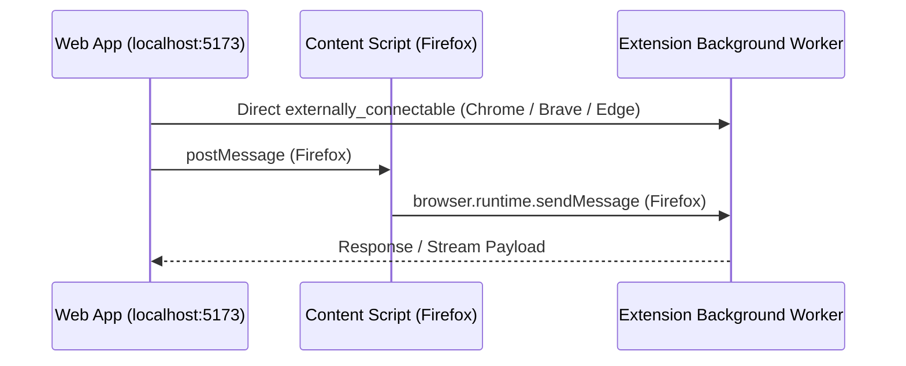

# Shared Bridge Protocol (`shared/`)

The `@bitchord/shared` workspace package defines the strongly-typed communication protocol and client used by both the Web Application (`app/`) and the Browser Extension (`extension/`).

## Directory Structure

```
shared/
└── src/
    ├── index.ts
    └── bridge/
        ├── protocol.ts   # RPC message types, event payloads, and API signatures
        ├── client.ts     # Client library running in web page context
        └── index.ts
```

## How the Bridge Operates



## Key Message Types in `protocol.ts`

- **Handshake**: `ping`, `version`, `status`
- **YouTube Auth**: `yt:getSession`, `yt:getCookies`
- **Spotify Auth**: `spotify:authorize`, `spotify:getToken`
- **Discord IPC**: `discord:setActivity`, `discord:clearActivity`
- **Network Proxying**: `fetch:request` (for requests requiring bypass of CORS or specific cookie headers)
